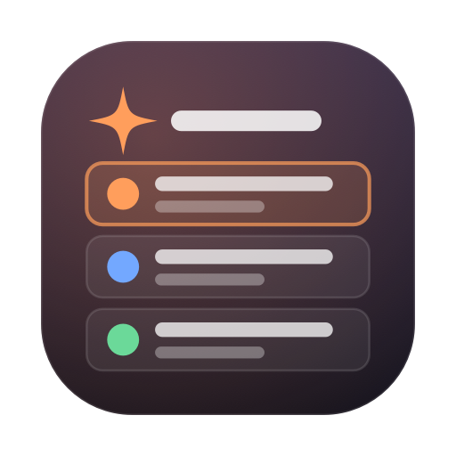
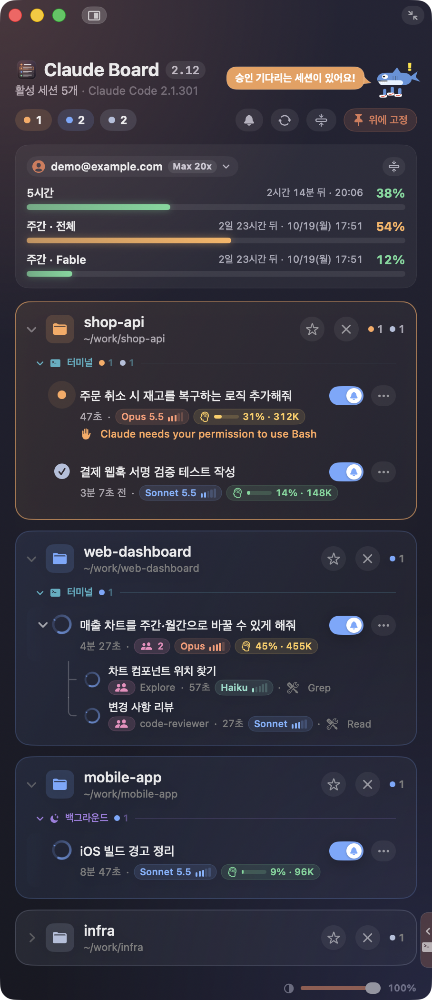
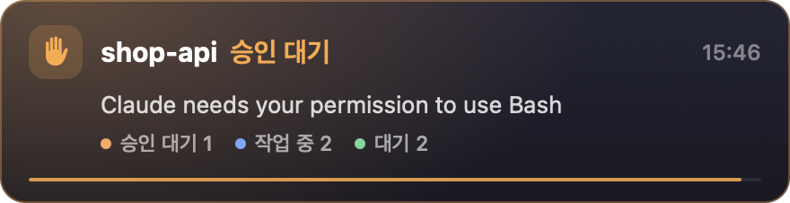
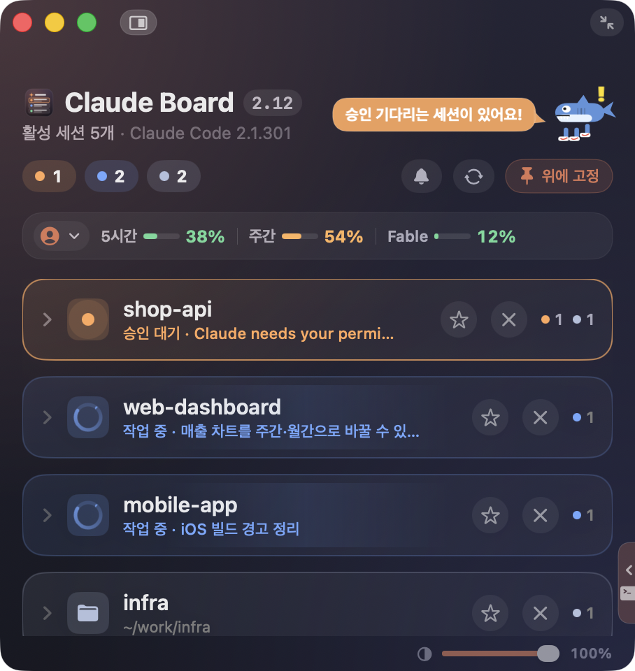
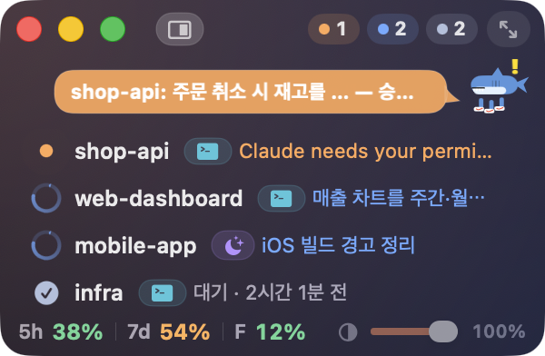
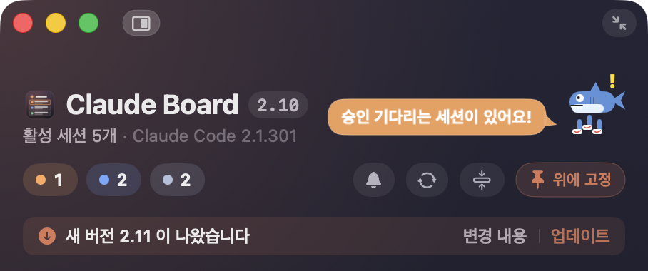

<p align="center"></p>

<h1 align="center">Claude Board</h1>

<p align="center">Claude Code 세션 여러 개를 한 화면에서 지켜보는 macOS 보드 앱</p>

<p align="center"></p>

버전별 변경은 [CHANGELOG.md](CHANGELOG.md), 모든 기능의 자세한 설명은 [설치 가이드](packaging/README.txt) 를 보세요.

## 💡 컨셉

Claude Code 를 여러 프로젝트 · 터미널 탭에서 함께 돌리면, 어느 세션이 승인을 기다리는지, 어느 세션이 응답을 끝냈는지 알려면 탭을 하나씩 돌아봐야 합니다.
Claude Board 는 그 확인을 보드 한 장으로 옮깁니다.

- 🗂️ **한눈에** — 작업 경로마다 카드 하나에 세션을 묶고, 급한 순서(승인 대기 → 작업 중 → 대기)로 보여 줍니다.
- 🔔 **놓치지 않게** — 승인이 필요하거나 응답이 끝나면 화면 가운데(메뉴에서 네 모서리로 바꿀 수 있음)에 알림 패널이 뜹니다. 키보드 입력은 가져가지 않습니다.
- 🎯 **바로 그 자리로** — 세션을 더블 클릭하면 그 세션의 터미널 탭으로 이동하고, 종료된 세션은 `claude --resume` 으로 이어 엽니다.
- 📊 **한도까지 함께** — 5시간 · 주간 사용 한도와 계정 전환을 보드에서 바로 다룹니다.

아이콘도 이 생각을 그대로 담았습니다. 상태 점(승인 대기 주황 · 작업 중 파랑 · 완료 초록)이 붙은 세션 카드가 보드에 쌓여 있습니다.

설치하면 Claude Code hook 이 세션마다 상태를 `~/.claude/notifier/sessions/` 에 기록하고, 보드와 알림 패널이 그 기록을 읽어 보여 줍니다.

## 🧰 필요한 환경

- 🍎 macOS 14(Sonoma) 이상 — Apple Silicon · Intel
- 🤖 Claude Code
- 🐍 python3 (`python3 --version` 이 나오면 됩니다. 없으면 `xcode-select --install`)
- 👻 세션 탭 이동 · 이어 열기는 Ghostty 1.3 이상에서만 동작합니다. 보드와 알림은 다른 터미널에서도 동작합니다.

## 📦 설치

```sh
curl -fsSL https://github.com/suhojang/claude-board/releases/latest/download/install.sh | bash
```

- ⚙️ 처음 설치할 때 `~/.claude/settings.json` 에 hook 11개와 환경변수 `CLAUDE_CODE_DISABLE_TERMINAL_TITLE=1` 을 등록할지 묻습니다.
  원본은 `settings.json.bak-claude-board-<날짜-시각>` 으로 백업하고, 다른 hook · 설정은 그대로 둡니다.
- 🔐 예전에 dmg 로 설치한 앱을 바꿀 때만 관리자 비밀번호 창이 한 번 뜹니다.
- 🎉 설치가 끝나면 보드가 열립니다. 이미 실행 중인 Claude Code 세션은 다시 시작해야 hook 이 적용됩니다.

설치하면 `/Applications/Claude Board.app`, `~/.claude/notifier/` 의 알림 패널 · hook 스크립트, 로그인 자동 실행(LaunchAgent),
`~/.local/bin` 의 `claude-board` · `claude-board-tui` 명령이 생깁니다. Ghostty 가 있으면 Ghostty 를 열 때 보드를 함께 띄우는 줄을 `~/.zshrc` 에 넣습니다.

## 🕹️ 사용법

### 🪟 보드 열기

- 🔁 로그인할 때 저절로 실행됩니다. Ghostty 가 있으면 Ghostty 를 열 때 보드가 꺼져 있으면 함께 띄웁니다.
- 🖱️ 메뉴 막대의 Claude Board 아이콘을 누르면 보드를 열고 닫습니다. 승인 대기 · 작업 중 세션 수도 함께 보입니다.
- ⌨️ 어느 앱에서든 ⌃⌥B 를 누르면 보드가 처음 크기로 화면 오른쪽에 붙어 앞으로 나옵니다.
- 💻 터미널에서 `claude-board` 는 보드 창을, `claude-board-tui` 는 터미널판 보드를 엽니다.

### ⚡ 자주 쓰는 조작

| 하고 싶은 것 | 방법 |
|---|---|
| 🧭 그 세션의 터미널로 가기 | 세션 줄을 더블 클릭 (Ghostty 1.3 이상) |
| ⏯️ 끝난 세션 이어 열기 | 종료된 세션을 더블 클릭 — Ghostty 새 pane 에서 `claude --resume` 으로 이어 엽니다 |
| 🔍 한 상태만 보기 | 윗줄의 상태 칩(승인 대기 · 작업 중 · 대기)을 누르기, 다시 누르면 모두 보기 |
| 👤 계정 바꾸기 | 사용 한도 카드 왼쪽 위 계정을 누르고 저장한 계정 고르기 (**계정 추가…** 로 미리 저장) |
| 🔀 한도가 차면 계정 자동 전환 | 계정 메뉴의 **한도가 차면 다른 계정으로 자동 전환** 을 켜기 (기본 꺼짐) — 한도로 멈춘 Ghostty 세션은 전환 40초 뒤 이어서 진행합니다 |
| 🔕 알림 끄기 | 세션 줄의 종 토글은 그 세션만, 윗줄의 종 단추는 전체 |
| 📍 알림 위치 바꾸기 | 메뉴 막대의 **Claude Board > 알림 위치** 에서 중앙(기본) · 왼쪽 상단 · 오른쪽 상단 · 왼쪽 하단 · 오른쪽 하단 |
| 🤏 창을 작게 두기 | 오른쪽 위 최대축소 단추(↘↖)로 미니 화면, 같은 자리의 ⤢ 로 원래 크기 |
| 🌫️ 다른 앱을 쓰는 동안 흐리게 | 오른쪽 아래 투명도 슬라이더 |
| 🎭 캐릭터 바꾸기 | 캐릭터를 오른쪽 클릭하거나 메뉴 막대의 **Claude Board > 캐릭터** |

제목 옆에는 Claude Board 버전이, 그 아래 활성 세션 수 옆에는 설치된 Claude Code 버전이 보입니다.

## 👀 화면 둘러보기

> ℹ️ 화면의 프로젝트 · 계정 · 사용량은 모두 예시 데이터입니다.

### 📋 보드 — 지금 어떤 세션이 무엇을 하고 있는지

맨 위 화면이 보드입니다. 작업 경로마다 카드 하나에 세션을 묶고, 급한 순서(승인 대기 → 작업 중 → 대기)로 보여 줍니다.

- 🚦 **윗줄 상태 칩**: 승인 대기(주황) · 작업 중(파랑) · 대기(회색) 세션 수입니다. 누르면 그 상태의 세션만 남깁니다.
- 📊 **사용 한도**: 5시간 · 주간 한도를 얼마나 썼는지와 언제 초기화되는지 보여 줍니다. 왼쪽 위 계정을 누르면 저장해 둔 다른 계정으로 바꿉니다.
- 📝 **세션 줄**: 마지막 요청 내용, 경과 시간, 응답한 모델과 effort(막대 5칸), 컨텍스트 사용량이 붙습니다. 승인 대기면 무엇을 기다리는지 주황 글씨로 나옵니다.
- 🧩 **서브에이전트**: 세션이 띄운 하위 작업이 아래에 이어지고, 지금 쓰는 도구(Grep · Read 등)가 보입니다.
- 💤 **백그라운드 · 조용한 카드**: 터미널 없이 도는 세션은 따로 묶이고, 30분 넘게 조용한 경로는 저절로 접힙니다.
- 🎭 **캐릭터**: 오른쪽 위 캐릭터가 세션 상황을 말풍선으로 알려 줍니다. 승인 대기가 있으면 재촉합니다.

### 🟠 승인이 필요할 때

<p align="center"></p>

Claude 가 도구 사용 승인을 기다리면 화면 가운데에 알림 패널이 뜹니다(메뉴 막대의 **Claude Board > 알림 위치** 에서 네 모서리 중 하나로 바꿀 수 있습니다). 키보드 입력을 가져가지 않으므로 터미널에 쓰던 프롬프트를 그대로 이어서 쓸 수 있습니다.
패널을 누르면 보드가 열리고, 누르지 않으면 10초 뒤 닫힙니다. 아래 줄은 지금 전체 세션의 상태별 개수입니다.

### 🟢 응답이 끝났을 때

<p align="center"></p>

응답이 끝나면 마지막 답변의 첫 문장을 보여 줍니다. 다른 창에서 일하다가도 어느 세션이 끝났는지 바로 알 수 있습니다.

### 📐 창을 줄였을 때 — 중간 화면

<p align="center"></p>

창 높이를 줄이면 사용 한도가 한 줄로, 경로 카드가 한 줄 요약으로 접힙니다. 접혀 있어도 작업 중이면 도는 링이, 승인 대기면 주황 표시와 승인 요청 내용이 보입니다.
카드를 누르면 그 카드만 펼쳐집니다.

### 🤏 화면 구석에 두고 볼 때 — 미니 화면

<p align="center"></p>

창을 더 줄이거나 오른쪽 위의 최대축소 단추(↘↖)를 누르면 경로마다 한 줄(상태 · 이름 · 터미널/백그라운드 · 지금 하는 일)로 보입니다.
줄을 한 번 누르면 그 세션의 터미널 앱이, 두 번 누르면 그 세션의 터미널 창이 앞으로 옵니다. 같은 자리의 ⤢ 를 누르면 원래 크기로 돌아갑니다.

### 🆕 새 버전이 나왔을 때

<p align="center"></p>

새 버전이 올라오면 윗줄 아래에 알림이 뜹니다. **변경 내용** 을 누르면 브라우저에서 [CHANGELOG.md](CHANGELOG.md) 가 열려 무엇이 바뀌었는지 볼 수 있고,
**업데이트** 를 누르면 새 버전으로 바꿔 끼우고 보드가 다시 열립니다.

## 🔄 업데이트

새 버전이 나오면 보드 윗줄 아래에 알림이 뜹니다. **변경 내용** 으로 바뀐 점을 확인하고, **업데이트** 를 누르면 새 버전으로 바꿔 끼우고 보드가 다시 열립니다.
위 설치 명령을 다시 실행해도 같습니다. hook 등록은 다시 묻지 않습니다.

새 버전은 보드를 켤 때와 그 뒤 1시간마다 확인합니다. 바로 확인하려면 윗줄의 업데이트 확인 단추(⟳)나 메뉴 막대의 **Claude Board > 업데이트 확인…** 을 누릅니다.
새 버전이 있으면 같은 알림이 뜨고, 없으면 "최신 버전입니다" 가 잠깐 보입니다.

## 🗑️ 제거

```sh
curl -fsSL https://raw.githubusercontent.com/suhojang/claude-board/main/packaging/Uninstall.command | bash
```

앱, 설치된 파일, settings.json 의 hook 과 환경변수, 자동 실행 등록, `~/.zshrc` 에 넣은 줄, 계정 전환용으로 저장한 로그인 정보를 지웁니다.
`/Applications` 의 앱을 지울 때 관리자 비밀번호를 묻습니다.

## 🛠️ 배포 (관리자)

1. [CHANGELOG.md](CHANGELOG.md) 맨 위에 새 버전 항목을 쓰고 commit · push 합니다.
2. `packaging/release.sh <버전>` — 앱을 빌드 · 서명하고 GitHub 릴리스를 만듭니다. 릴리스 설명은 CHANGELOG 의 그 버전 항목입니다.

서명에는 `packaging/make-cert.sh` 로 만든 개인 인증서(Claude Board Signing)가 필요합니다. 인증서를 바꾸면 사용자 Mac 에서 Ghostty 제어 권한을 다시 묻고, `install.sh` 가 설치를 거부합니다.

## 🤝 기여

이슈와 PR 을 환영합니다. PR 은 저장소 관리자([@suhojang](https://github.com/suhojang))가 검토하고 승인한 뒤 머지합니다.
보낸 기여는 아래 Apache License 2.0 으로 배포되는 것에 동의한 것으로 봅니다(라이선스 5조).

## 📄 라이선스

[Apache License 2.0](LICENSE) · Copyright 2026 suhojang

Claude Board 는 개인이 만든 비공식 도구로, Anthropic 이 만들거나 보증하지 않습니다. Claude 와 Claude Code 는 Anthropic 의 상표입니다.
